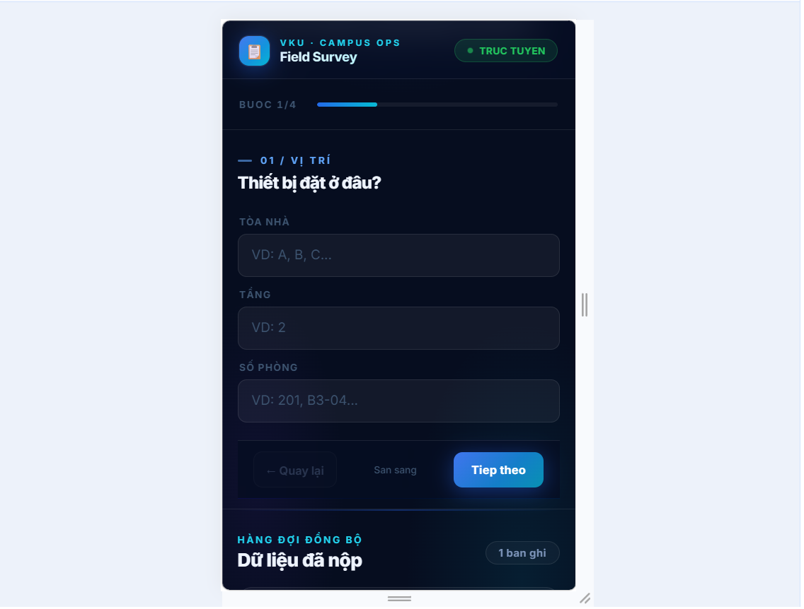
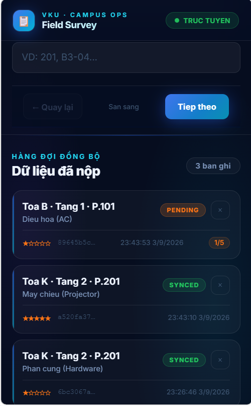
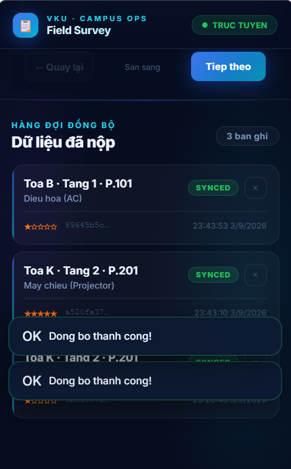
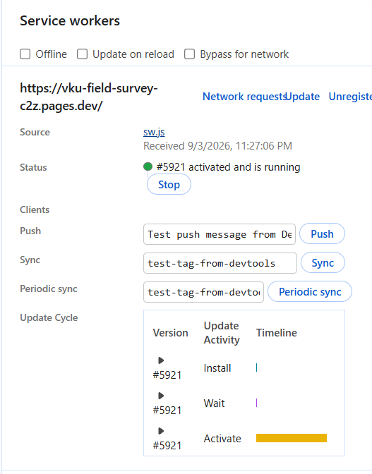

# MINI-PROJECT SHORT TECHNICAL REPORT
**Course:** Cross-Platform Mobile App Development (VKU)
**Mini-Project Title:** Mini-Project 1 — VKU Field Survey (Offline-First Campus Inspection App)
**Team / Student Name:** Phan Đình Thắng
**Submission Date:** 11/10/2026

---

## 1. GENERAL INFORMATION & DELIVERABLE LINKS
* **Team Members:**
  1. Phan Đình Thắng — Student ID: 23IT.B207 — Lớp: 23SE4 — Role: Team Lead / Frontend Architecture & Offline Sync — Contribution: 100%
* **🔗 Live Demo URL:** https://vku-field-survey-c2z.pages.dev/
* **💻 GitHub Repository:** https://github.com/pdthang125/project1.git
* **🎥 Video Demo (Optional):** [PASTE YOUR VIDEO LINK HERE]

> Ghi chú: Worker API deploy tại `https://vku-field-survey-api.workers.dev` (endpoint `POST /api/surveys`).

---

## 2. FEATURE IMPLEMENTATION CHECKLIST
| # | Required Feature | Status | Implementation Details & Acceptance Level |
|:---:|---|:---:|---|
| 1 | Responsive Mobile Viewport & Standalone PWA | ✅ Complete | Giao diện responsive trên viewport mobile; `manifest.json` với `theme_color #0284c7`, icon 192×512 px, `display: standalone`. Service Worker `sw.js` cache-first pre-cache app shell, hoạt động offline 100%. |
| 2 | Local Offline Persistence (IndexedDB) | ✅ Complete | Thư viện `idb` quản lý 2 object store: `drafts` (tự lưu nháp, debounce 700ms) và `surveys` (key = UUID `crypto.randomUUID()`, index `by-status`). Dữ liệu tồn tại qua reload và Airplane Mode. |
| 3 | Automatic Background Sync | ✅ Complete | 3 cơ chế song song cùng gọi `processSyncQueue()`: (1) Background Sync API tag `sync-surveys`; (2) `window.ononline` fallback; (3) Capacitor `Network.addListener` cho native Android. Gửi POST tuần tự, tối đa 5 lần retry, có nút Retry thủ công. |

Các tính năng bổ sung đã hoàn thành:

| # | Feature | Status | Details |
|:---:|---|:---:|---|
| 4 | Multi-Step Survey Form (4 bước) | ✅ Complete | Bước 1 Vị trí (Tòa/Tầng/Phòng) → Bước 2 Danh mục (Hardware/Projector/AC/Electrical/Furniture) → Bước 3 Đánh giá 1–5 sao → Bước 4 Ghi chú + Ảnh + GPS. Validate từng bước, progress bar thời gian thực. |
| 5 | Draft Auto-Save & Restore | ✅ Complete | `scheduleDraft()` debounce 700ms; khi mở lại app `boot()` khôi phục toàn bộ trường, rating, ảnh. |
| 6 | UUID + Timestamp + GPS per Record | ✅ Complete | Mỗi record có UUID, `Date.now()`, tọa độ GPS; GPS từ chối → ghi `null`, form vẫn submit. |
| 7 | Sync Queue UI (PENDING / SYNCED / FAILED) | ✅ Complete | Danh sách record dạng card, badge trạng thái, bộ đếm attempt `x/5`, nút xóa & retry, sắp xếp theo thời gian. |
| 8 | Cloudflare Worker API (Backend) | ✅ Complete | `POST /api/surveys` validate đầy đủ (string fields, timestamp number, category enum, rating 1–5), `GET /api/health`, CORS mọi origin. |
| 9 | Native Android App (Capacitor 7) | ✅ Complete | `appId: vn.edu.vku.fieldsurvey`, plugin Camera / Geolocation / Network, build debug & release APK. |

---

## 3. TECHNICAL ARCHITECTURE & PROJECT STRUCTURE

### Sơ đồ kiến trúc tổng thể

```
┌─────────────────────────────────────────────────────────────┐
│                       CLIENT LAYER                          │
│                                                             │
│   HTML/CSS/TS (Vite)  ←→  main.ts (UI Logic)               │
│         │                     │                             │
│         ▼                     ▼                             │
│   Service Worker          db.ts (idb)                       │
│   (cache-first)       ┌───────────────┐                     │
│         │             │  IndexedDB    │                     │
│         │             │  - drafts     │                     │
│         │             │  - surveys    │                     │
│         │             │    (by-status)│                     │
│         │             └───────────────┘                     │
│         │                     │                             │
│         │             sync-queue.ts                         │
│         │          (processSyncQueue)                       │
│         │                     │                             │
└─────────┼─────────────────────┼─────────────────────────────┘
          │                     │ POST /api/surveys
          ▼                     ▼
   Cloudflare Pages    Cloudflare Worker API
   (Static Hosting)   vku-field-survey-api.workers.dev
```

### Cấu trúc thư mục

```
project1/
├── frontend/
│   ├── src/
│   │   ├── main.ts             # Entry: DOM wiring, boot(), submit(), render queue/modal
│   │   ├── db.ts               # IndexedDB schema & CRUD (idb): drafts + surveys
│   │   ├── sync-queue.ts       # processSyncQueue(), initSyncListeners()
│   │   ├── capacitor-bridge.ts # Camera, Geolocation, Network (native + web fallback)
│   │   └── sw-register.ts      # Service Worker registration
│   ├── public/
│   │   ├── sw.js               # Service Worker (cache-first + Background Sync)
│   │   ├── manifest.json       # PWA manifest
│   │   └── icons/              # App icons
│   └── android/                # Capacitor Android project (vn.edu.vku.fieldsurvey)
├── worker/
│   └── src/index.ts            # Cloudflare Worker: validate + log surveys
├── docs/                       # Báo cáo & screenshots
└── package.json                # Root scripts (dev/build/deploy)
```

### Quản lý state & luồng dữ liệu

1. **Nhập liệu** → sự kiện `input` → `scheduleDraft()` debounce 700ms → `saveDraft()` → IndexedDB store `drafts` (một bản ghi, ghi đè).
2. **Nộp form** → `submit()` → `getCurrentLocation()` lấy GPS → `addSurvey()` tạo record `status: 'PENDING_SYNC'` trong store `surveys` → `deleteDraft()`.
3. **Đồng bộ** → `processSyncQueue()` lọc record `PENDING_SYNC` qua index `by-status` → `fetch POST /api/surveys` tuần tự → thành công: `updateSurveyStatus('SYNCED')`; lỗi: `incrementSyncAttempts()`.
4. **Trigger sync** từ 3 nguồn: Service Worker `sync` event (`postMessage TRIGGER_SYNC`), `window.ononline`, và Capacitor `networkStatusChange`.

### Chiến lược xử lý ngoại lệ

| Tình huống | Xử lý |
|---|---|
| GPS bị từ chối / timeout (10s) | `try/catch` trả `{latitude:null,...}`, form vẫn nộp bình thường |
| Network lỗi khi sync | `incrementSyncAttempts()`, giữ `PENDING_SYNC`, hiện toast lỗi |
| Quá 5 lần thử (`MAX_SYNC_ATTEMPTS`) | Bỏ qua trong vòng lặp tự động, badge chuyển `FAILED`, hiện nút Retry |
| Background Sync không hỗ trợ (Firefox/Safari) | Fallback `window.ononline` + Capacitor Network listener |
| Camera bị từ chối (native) | `try/catch` trả `null`, ảnh là tùy chọn, form không bị chặn |
| JSON request không hợp lệ | Worker trả HTTP 400 kèm message lỗi cụ thể |

---

## 4. EMPIRICAL EVIDENCE & SCREENSHOTS

**Ảnh 1 — Form khảo sát đa bước chạy trên thiết bị / emulator**


**Ảnh 2 — Hàng đợi đồng bộ với trạng thái PENDING_SYNC**


**Ảnh 3 — Trạng thái SYNCED sau khi đồng bộ thành công**


**Ảnh 4 — Service Worker đã activated & Background Sync tag `sync-surveys` trong DevTools**


> Khuyến nghị bổ sung: screenshot APK chạy trên thiết bị Android thật, output `apksigner verify --print-certs`, và PWA Manifest (theme color `#0284c7`).

---

## 5. TECHNICAL CHALLENGES & RESOLUTIONS

### Thách thức 1: Background Sync API không đồng nhất giữa các nền tảng

**Vấn đề:** Background Sync API chỉ được hỗ trợ đầy đủ trên Chromium (Chrome, Edge). Trên Firefox và Safari/iOS, `registration.sync.register('sync-surveys')` có thể throw exception. Nếu chỉ phụ thuộc vào một cơ chế duy nhất, dữ liệu sẽ không tự đồng bộ trên các nền tảng này.

**Giải pháp:** Triển khai kiến trúc sync **3 tầng dự phòng**, tất cả cùng gọi `processSyncQueue()`:
1. **Background Sync API** (Chromium) — Service Worker lắng nghe `sync` event rồi `postMessage('TRIGGER_SYNC')` về main thread.
2. **`window.ononline`** — fallback cho mọi trình duyệt khi tab đang mở và kết nối phục hồi.
3. **Capacitor `Network.addListener('networkStatusChange')`** — API native chính xác hơn trên Android, không phụ thuộc browser event.

Nhờ đó app đồng bộ nhất quán trên mọi môi trường (Chromium, Firefox, Safari, native Android).

### Thách thức 2: Quản lý trạng thái sync & tránh retry vô hạn

**Vấn đề:** Khi backend lỗi tạm thời (timeout, 5xx) hoặc offline kéo dài, cần phân biệt "đang chờ sync" với "thất bại nhiều lần" để tránh vòng lặp retry vô hạn gây tốn băng thông/pin, đồng thời cho người dùng quyền retry thủ công.

**Giải pháp:** Thiết kế state machine cho mỗi record trong IndexedDB:
- Trường `syncAttempts` tăng dần sau mỗi lần lỗi (`incrementSyncAttempts()`).
- Khi `syncAttempts >= 5` (`MAX_SYNC_ATTEMPTS`): bỏ qua trong vòng lặp tự động và đổi badge thành `FAILED`.
- Nút **Retry** trong UI gọi `resetSyncAttempts()` đặt lại về 0 + `PENDING_SYNC` rồi kích hoạt sync ngay.
- Worker trả message lỗi cụ thể trong body HTTP 400, hiển thị toast cho người dùng.

### Thách thức 3 (bổ sung): Tích hợp Capacitor native với web fallback

**Vấn đề:** App phải chạy cả trên browser (PWA) lẫn native Android. Các plugin Capacitor (Camera/Geolocation/Network) chỉ hoạt động trong môi trường native; trên web cần cơ chế thay thế.

**Giải pháp:** Tạo abstraction layer `capacitor-bridge.ts` dùng `Capacitor.isNativePlatform()` để chọn API. Ví dụ `takePhoto()`: native dùng `Camera.getPhoto` (base64, quality 70), còn web dùng `<input type="file" accept="image/*" capture="environment">` rồi đọc bằng `FileReader`. Nhờ vậy `main.ts` chỉ cần gọi một hàm duy nhất, cùng một codebase chạy trên mọi nền tảng.

---

**End of Report**

*Prepared by: Phan Đình Thắng — 23IT.B207 — Lớp 23SE4*
*Date: 11/10/2026*
*VKU — Cross-Platform Mobile App Development*
